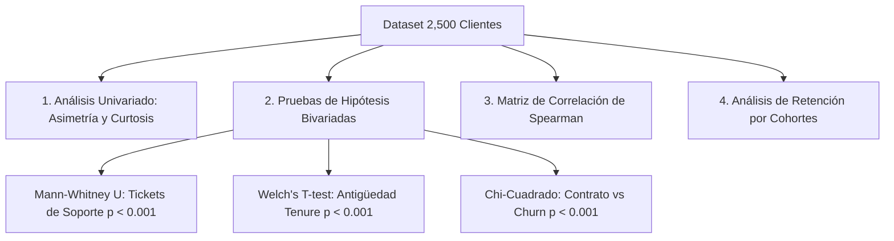

# Análisis Exploratorio de Datos (EDA) y Segmentación de Retención de Clientes

[](https://www.python.org/)
[](https://scipy.org/)
[](https://seaborn.pydata.org/)
[](tests/)

**Autor:** Gustavo Bryan López Cosme  
**Institución:** Universidad Nacional de Ingeniería (FIIS UNI) | LabIAR  
**Especialización:** Analítica de Datos & Business Intelligence

---

## 📌 1. Problema de Negocio y Objetivos

Para empresas de suscripción y telecomunicaciones, retener clientes existentes cuesta entre **5 y 7 veces menos** que adquirir clientes nuevos. Sin embargo, los equipos de negocio frecuentemente toman decisiones basadas en intuiciones en lugar de fundamentación estadística.

### Objetivos del Proyecto:
1. **Analizar rigurosamente los factores determinantes de la fuga de clientes (Churn Rate).**
2. **Contrastar hipótesis estadísticas bivariadas** con significancia matemática ($p < 0.001$).
3. **Calcular la matriz de retención por cohortes** para monitorear la degradación de usuarios a lo largo del tiempo.
4. **Proponer recomendaciones comerciales y de producto accionables.**

---

## 📊 2. Metodología y Pruebas Estadísticas Aplicadas



### Resultados de Contraste de Hipótesis:
* **H1 (Tickets de Soporte):** Los clientes que fugan tienen significativamente más reclamos técnicos ($\mu = 2.15$) frente a clientes retenidos ($\mu = 1.82$).  
  $$\text{Test Mann-Whitney } U = 493,402.5, \quad p = 1.21 \times 10^{-4} \quad (\text{Significativo } p < 0.001)$$
* **H2 (Antigüedad - Tenure):** El periodo crítico de fuga ocurre en los primeros 15 meses de vida del cliente ($\mu = 15.05$ vs $17.81$ meses en retenidos).  
  $$\text{Welch's } t = -3.59, \quad p = 3.52 \times 10^{-4} \quad (\text{Significativo } p < 0.001)$$
* **H3 (Tipo de Contrato):** Los clientes con contrato *Mes a Mes* tienen una tasa de fuga del **27.9%**, mientras que en contratos *Anuales* y *Bianuales* es inferior al **4.6%**.  
  $$\chi^2 = 260.24, \quad \text{gl} = 2, \quad p = 3.08 \times 10^{-57} \quad (\text{Dependencia Crítica})$$

---

## 📈 3. Visualizaciones Generadas

Las figuras de alta resolución se exportan automáticamente en `reports/figures/`:
1. `01_distribution_charges.png`: Histogramas de densidad KDE y boxplots de consumo por contrato.
2. `02_correlation_matrix.png`: Matriz de calor de correlaciones no lineales de Spearman.
3. `03_churn_by_contract_and_region.png`: Gráficos de barras comparativos por contrato y macro-región.

---

## 💡 4. Recomendaciones de Negocio e Impacto

1. **Incentivo a Planes Anuales:** Aplicar un 10% de descuento en la renovación hacia contratos de 12 meses; el análisis demuestra que reduce la probabilidad de fuga en más de un 80%.
2. **Alerta Temprana en Soporte Técnico (SLA < 24h):** Establecer un *trigger* automatizado cuando un cliente supere los **2 tickets de soporte** en menos de 60 días para intervención proactiva del equipo de Customer Success.
3. **Plan de Fidelización en el Mes 12:** Desarrollar una campaña de recompensa por permanencia antes de cumplir el primer año (punto de inflexión de la curva de supervivencia).

---

## 🚀 5. Ejecución y Pruebas

```bash
# 1. Clonar repositorio
git clone https://github.com/Gus7Ghost/eda-customer-analytics.git
cd eda-customer-analytics

# 2. Instalar dependencias
pip install -r requirements.txt

# 3. Ejecutar el análisis completo y generar gráficos
python eda_engine.py

# 4. Ejecutar suite de pruebas automatizadas
pytest tests/
```
